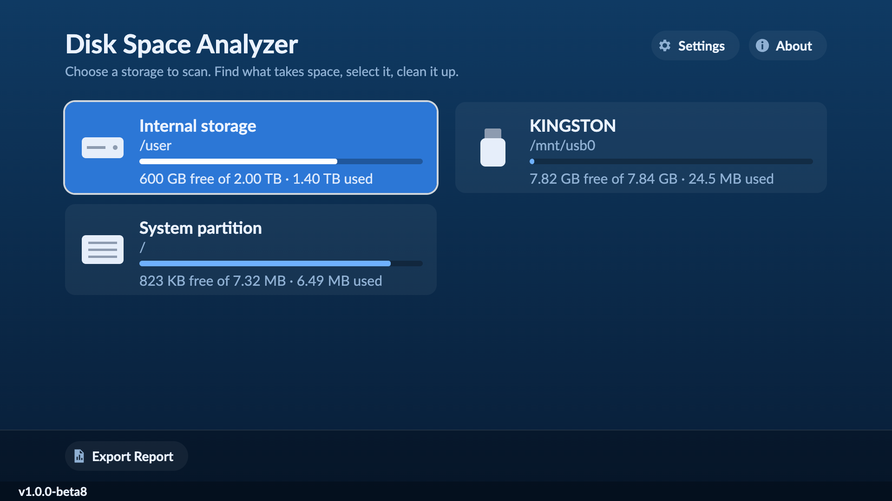
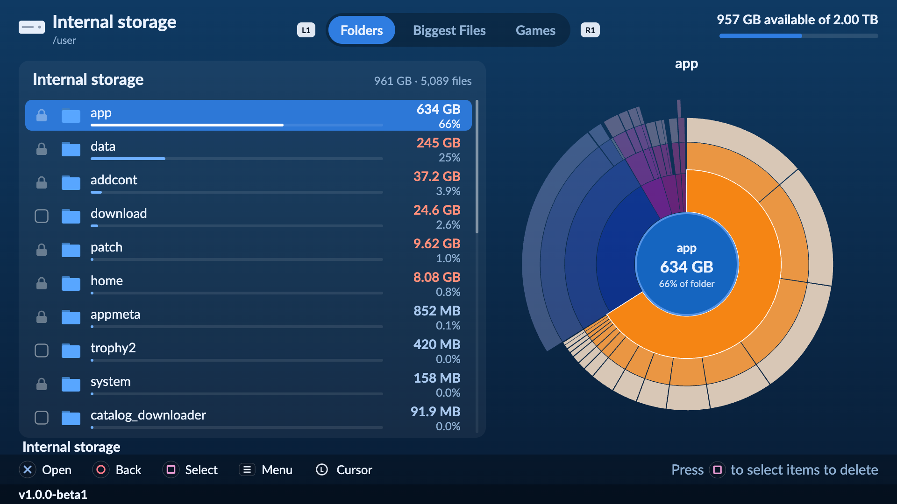
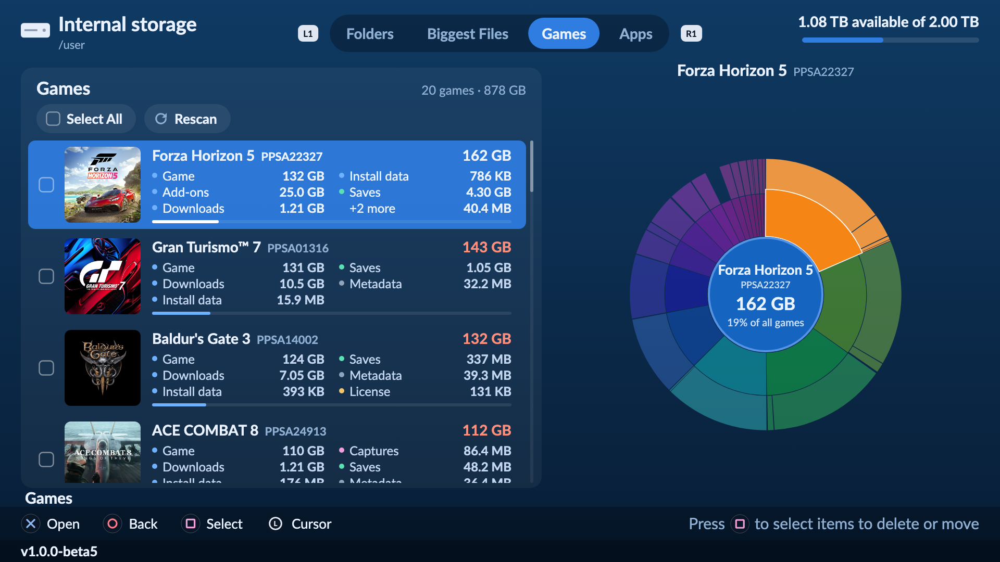

# Disk Space Analyzer for PS5

**Running out of space on your PS5? Find out where it went.**

The PS5 storage screen lumps a lot of data under "Other", and that "Other" can
take up a big part of your drive with no way to see what is in it. Disk Space
Analyzer is a handy PS5 utility that shows which games and folders are taking
up space, so you can choose what to remove.



## What you can do

- 🔍 **Scan any drive:** internal storage, M.2 expansion or a USB drive.
- 📊 **See where the space goes:** folders sorted by size, next to a colour chart
  that shows the biggest items at a glance.
- 🎮 **Check each game's real size:** the game, its updates, add-ons, saves,
  screenshots, clips and downloads, all added up in one place, with the game's
  cover and name.
- 📁 **Find the biggest files** on the drive in one list.
- 🧹 **Clean up safely:** select what you don't need and see how much space you'll
  get back before you delete. System files are locked, so you can't remove
  anything the console needs.
- 📄 **Export a report:** pick one drive or all of them and save one HTML file
  with every folder and file and the space each takes, to keep or share. It
  opens in any browser.
- 📱 **Use your phone or PC:** the same app opens in any browser on your home
  network.





## Get started

You need a jailbroken PS5 with an ELF loader.

1. Download `disk-space-analyzer.elf` from the
   [Releases](../../releases) page.
2. Send it to your console's ELF loader (port 9021).
3. Open the **Media** section on the PS5 home screen and start
   **Disk Space Analyzer**.

The app runs until you restart the console. After a restart, send the file
again (or add it to your autoload). The Media tile stays installed.

To use it from your phone or PC, open the **Remote Management** address shown
at the bottom of the app, such as `http://192.168.1.20:8833/`.

## Build from source

Needs `cmake`, `clang` and `lld`. On macOS: `brew install llvm lld cmake`.

```sh
make toolchain              # download the PS5 payload SDK (once, ~700 MB)
make package                # build dist/disk-space-analyzer.elf
make send PS5_HOST=<ps5-ip> # send it to your console
```

To try the app on your computer without a PS5:

```sh
make run                    # then open http://localhost:8833/
```

## Credits

- Media tile approach from
  [ps5-web-file-manager](https://github.com/owendswang/ps5-web-file-manager).
- Font: [Lato](https://www.latofonts.com/) (SIL Open Font License).
